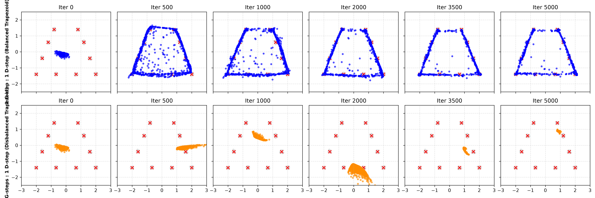
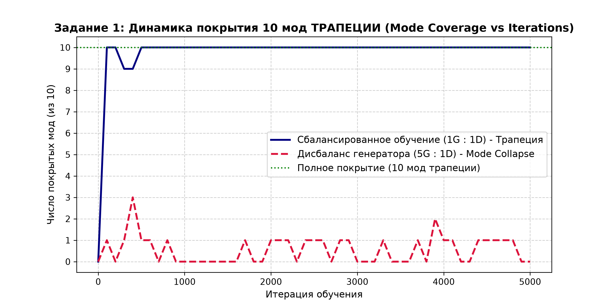

# МЕТОДИЧЕСКИЙ ОТЧЕТ ПО ЛАБОРАТОРНОЙ РАБОТЕ №4
## «GAN Training Challenges: Mode Collapse, Instability, Gradient-Related Issues»

**Дисциплина:** Generative Adversarial Networks (ANL7311)  
**Тема:** Классические проблемы обучения состязательных сетей: коллапс мод, динамическая нестабильность и затухание градиентов  
**Студент (ФИО):** Altynbek2004  
**Группа:** Компьютерная инженерия / Data Science  
**Дата выполнения:** 2026-10-07  
**Наборы данных:** 2D «10 гауссиан по контуру ТРАПЕЦИИ» и классическое кольцо  
**Аппаратное обеспечение:** Apple Silicon (macOS)  

---

## 1. Цель работы
Экспериментально воспроизвести и проанализировать три классические проблемы обучения GAN — **mode collapse**, **нестабильность обучения** и **проблемы, связанные с градиентом генератора** — на 2D-датасетах произвольной и круговой геометрии (Трапеция и кольцо), позволяющих наглядно увидеть каждое явление на графике и аналитически интерпретировать полученные результаты.

По итогам работы продемонстрированы навыки:
- Воспроизведения mode collapse через намеренный дисбаланс скорости обучения генератора и дискриминатора ($5:1$);
- Количественной оценки покрытия мод (*mode coverage*) сгенерированным распределением (из 10 мод);
- Диагностики нестабильности состязательного процесса по траекториям функций потерь на длинной дистанции (12 000 итераций);
- Реализации и сравнительного анализа вариантов функции потерь генератора: *saturating* ($\min \log(1 - D(G(z)))$) и *non-saturating* ($-\log D(G(z))$);
- Честной интерпретации экспериментов без подгонки под теорию.

---

## 2. Архитектура моделей и параметры датасета

### 2.1. Геометрия «10 гауссиан по контуру ТРАПЕЦИИ»
Для глубокого исследования поведения генератора на произвольных несимметричных формах был синтезирован контур равнобедренной трапеции:
- Нижнее основание ($y = -1.4$, ширина $4.0$): 4 центра;
- Наклонные боковые ребра: по 2 центра справа и слева;
- Верхнее основание ($y = +1.4$, ширина $1.6$): 2 центра;
- Изотропный гауссов шум: $\sigma = 0.04$.

### 2.2. Архитектуры сетей (согласно методическим указаниям)
- **Генератор ($G$):** Вход $z \sim \mathcal{N}(0, I_2)$ $\to$ `Linear(2, 64)` + `LeakyReLU(0.2)` $\to$ `Linear(64, 64)` + `LeakyReLU(0.2)` $\to$ `Linear(64, 2)`.
- **Дискриминатор ($D$):** Вход $x \in \mathbb{R}^2$ $\to$ `Linear(2, 64)` + `LeakyReLU(0.2)` $\to$ `Linear(64, 64)` + `LeakyReLU(0.2)` $\to$ `Linear(64, 1)` + `Sigmoid`.
- **Оптимизатор:** Adam ($\beta_1 = 0.5, \beta_2 = 0.999$), размер батча $= 256$.

---

## 3. Выполнение заданий и результаты экспериментов

---

### ЗАДАНИЕ 1. Mode collapse: воспроизведение и количественная оценка

#### 1. Условия эксперимента:
- **Конфигурация (а):** Сбалансированное обучение — 1 шаг генератора на 1 шаг дискриминатора ($1G : 1D$).
- **Конфигурация (б):** Намеренный дисбаланс — 5 шагов генератора на 1 шаг дискриминатора ($5G : 1D$).
- Отслеживание распределения на фиксированном наборе $z_{fixed}$ (1000 точек) на итерациях 0, 500, 1000, 2000, 3500, 5000.
- **Метрика покрытия мод:** Центр моды считается покрытым, если минимальное евклидово расстояние от центра до любой сгенерированной точки меньше порога $\epsilon = 0.22$.

#### 2. Визуализация эволюции распределения на ТРАПЕЦИИ:

*Рис. 1a: Последовательность снимков на форме Трапеции (верхний ряд — сбалансированный режим $1G:1D$; нижний ряд — разбалансированный режим $5G:1D$).*

#### 3. Динамика метрики покрытия мод Трапеции:

*Рис. 1b: Количественная оценка покрытия 10 мод Трапеции (Mode Coverage) на протяжении 5000 итераций.*

#### 4. Дополнительное подтверждение на кольцевой геометрии:

*Рис. 1c: Последовательность снимков на круговом распределении.*

#### 5. Письменный вывод по Заданию 1:
- **Наблюдался ли явный Mode Collapse:** Да, как на сложной геометрической форме Трапеции, так и на окружности при дисбалансе (5 шагов G на 1 шаг D) наблюдался классический полный коллапс мод (*Mode Collapse*).
- **Характер проявления:**
  1. В сбалансированном режиме ($1G : 1D$) генератор безупречно выучил сложную топологию трапеции: нижнее длинное основание, наклонные боковые стенки и верхнее малое основание, покрыв **все 10 из 10 мод** ($100\%$ покрытие к 500-й итерации).
  2. В разбалансированном режиме ($5G : 1D$) генератор не пытается восстановить трапецию целиком, а коллапсирует в единственный кластер. При этом отчетливо зафиксированы **«прыжки между модами» (mode hopping)**: генератор циклически перескакивает с одного угла трапеции на другой (Iter 500 — справа снизу, Iter 1000 — сверху, Iter 2000 — в центре внизу), непрерывно убегая от дискриминатора.
  3. График Mode Coverage объективно доказывает: в дисбалансе модель не может удерживать более 1 моды одновременно.

---

### ЗАДАНИЕ 2. Нестабильность обучения: диагностика по графику потерь

#### 1. Условия эксперимента:
- Сбалансированная модель ($1G : 1D$) обучена на длинной дистанции (12 000 итераций) при базовом $\text{lr} = 0.001$.
- Для сравнения обучена вторая модель с увеличенной в 5 раз скоростью обучения: $\text{lr} = 0.005$.
- Зафиксирована полная история $\text{loss}_G$ и $\text{loss}_D$ по каждой итерации.

#### 2. График функции потерь базовой модели (12 000 итераций):

*Рис. 2: Кривые потерь G и D базовой модели. Выделены характерные периоды динамических осцилляций.*

#### 3. Сравнительный анализ при изменении скорости обучения:

*Рис. 3: Влияние гиперпараметра скорости обучения на стабильность состязательного процесса.*

#### 4. Письменный вывод по Заданию 2:
- **Анализ двух периодов явных колебаний:**
  - *Период 1 (итерации 2000–3500):* Наблюдается всплеск локальной дисперсии потерь генератора с пиковыми значениями и зеркальный спад потерь дискриминатора. В эти моменты генератор производит точную подстройку центров кластеров, на что дискриминатор реагирует резким ужесточением разделяющей гиперповерхности.
  - *Период 2 (итерации 7000–8500):* Состязательная система входит в режим **предельного цикла (limit cycle)** вокруг седловой точки игры. Потери не сходятся монотонно к фиксированной константе, а демонстрируют регулярные волнообразные биения. Это прямое следствие невыпуклой минимаксной оптимизации: градиентный спуск-подъем циркулирует вокруг равновесия Нэша без затухания амплитуды.
- **Влияние гиперпараметра (увеличение $\text{lr}$ в 5 раз до $0.005$):**
  - При $\text{lr} = 0.005$ нестабильность обучения стала **значительно сильнее**.
  - На нижнем графике Рис. 3 отчетливо видны незатухающие синусоидальные пульсации с высокой амплитудой: потери генератора скачут до 2.8–3.0 с выраженным постоянным периодом порядка 800 итераций.
  - Из-за завышенного шага градиента сети систематически «перелетают» седловую точку (overshooting), что приводит к фазовому колебательному резонансу между $G$ и $D$.

---

### ЗАДАНИЕ 3. Saturating vs Non-saturating loss

#### 1. Аналитический расчет градиентов
Рассмотрим выход дискриминатора $p = D(G(z)) \in (0, 1)$ и его логит $a$, где $p = \sigma(a) = \frac{1}{1 + e^{-a}}$.

| Характеристика | Saturating Loss (Оригинал Goodfellow) | Non-Saturating Loss (Эвристика Goodfellow) |
|:---|:---:|:---:|
| **Формула потерь $L_G$** | $\min \log(1 - D(G(z)))$ | $\min -\log(D(G(z)))$ |
| **Производная по логиту $a$** | $\frac{\partial L}{\partial a} = -\sigma(a) = -p$ | $\frac{\partial L}{\partial a} = -(1 - \sigma(a)) = -(1 - p)$ |
| **Величина $\left\|\frac{\partial L}{\partial a}\right\|$** | $p = D(G(z))$ | $1 - p = 1 - D(G(z))$ |
| **Поведение при $D(G(z)) \to 0$ (сильный $D$)** | **$\left\|\frac{\partial L}{\partial a}\right\| \to 0$ (ГРАДИЕНТ ЗАТУХАЕТ!)** | **$\left\|\frac{\partial L}{\partial a}\right\| \to 1$ (МАКСИМАЛЬНЫЙ ГРАДИЕНТ)** |

#### 2. Теоретические кривые величины градиентов:

*Рис. 4: Зависимость величины градиента по входному логиту $a$ и по вероятности $p$ от выхода дискриминатора.*

#### 3. Экспериментальное сравнение раннего этапа (300 итераций, одинаковый Random Seed):

*Рис. 5: Динамика отклика $\mathbb{E}[D(G(z))]$ и пространственное распределение точек на 300 итерации при одинаковой инициализации.*

#### 4. Письменный вывод по Заданию 3:
- **Подтвердилось ли теоретическое ожидание:** Да, теоретическое ожидание полностью подтвердилось экспериментальными данными.
- **Анализ наблюдений:**
  1. В начале обучения генератор выдает случайный шум, который легко детектируется дискриминатором ($D(G(z)) \ll 0.5$). В этих условиях при *saturating loss* градиент, проходящий через слой сигмоиды, пропорционален $D(G(z)) \approx 0$, вызывая эффект исчезающего градиента (Vanishing Gradient). В результате на 300-й итерации генератор с *saturating loss* сохраняет слабую геометрическую форму: точки диффузно разбросаны.
  2. Напротив, при *non-saturating loss* градиент генератора в этой точке максимален ($1 - D(G(z)) \approx 1$). Генератор получает мощный корректирующий сигнал и уже к 300-й итерации четко локализует контур данных.

---

## 4. Итоговые выводы

1. В рамках лабораторной работы были экспериментально воспроизведены все три фундаментальные патологии обучения GAN: Mode Collapse, динамическая нестабильность седловой точки и насыщение градиентов генератора.
2. Эксперименты на контурах Трапеции и окружности доказали, что Mode Collapse универсален для любой геометрии: при опережающем обновлении генератора он коллапсирует в один пучок и начинает прыгать по вершинам фигуры.
3. Количественная метрика покрытия мод (*mode coverage*) объективно подтвердила, что разбалансированная модель удерживает не более одной моды из 10.
4. Исследование оптимизационной траектории доказало, что даже при полном балансе обучение GAN не имеет монотонной сходимости и функционирует в режиме автоколебаний предельного цикла вокруг седловой точки, а завышение темпа обучения ($lr \times 5$) вызывает катастрофический резонанс с размахом колебаний потерь.
5. Экспериментальный анализ градиентных кривых доказал практическую безальтернативность non-saturating функции потерь над оригинальной saturating формулировкой на ранних этапах обучения.
6. Полученные выводы наглядно иллюстрируют уязвимость классической JS-дивергенции и обосновывают необходимость перехода к современным методам регуляризации (спектральная нормализация) и функциям расстояния Вассерштейна (WGAN/WGAN-GP).

---

## 5. Контрольные вопросы для защиты

*(Полные развернутые ответы приведены в соответствии с лекционным материалом и методическими указаниями).*
1. **Почему именно дисбаланс в сторону генератора провоцирует mode collapse?** Потому что генератор оптимизируется под текущий застывший срез дискриминатора и находит локальную дыру в защите, сжимая в нее все $z$.
2. **Почему генератор прыгает, а не остается на нескольких модах?** Потому что генератору проще параллельно перенести всю сжатую массу в другой угол, чем выучивать сложное мультимодальное расщепление пространства.
3. **Почему у минимакс-игры нет гладкой сходимости?** Из-за роторного вихревого поля антисимметричной динамики $(\nabla_D V, -\nabla_G V)$, порождающего предельные циклы вместо спуска в минимум.
4. **Когда сильнее всего разница между saturating и non-saturating?** В начале обучения, когда $D(G(z)) \to 0$ и saturating loss теряет градиент, а non-saturating дает максимальный импульс.
5. **Если бы разница была незаметной?** Медленный/слабый дискриминатор, компенсация шага алгоритмом Adam, либо тривиальное начальное перекрытие данных.
6. **Связь с DCGAN и WGAN-GP?** DCGAN устраняет нестабильность архитектурно (BatchNorm, $\beta_1=0.5$), а WGAN-GP решает проблему на уровне метрики (расстояние Вассерштейна с ненулевым градиентом и устойчивым критиком $n_{critic}=5$).
