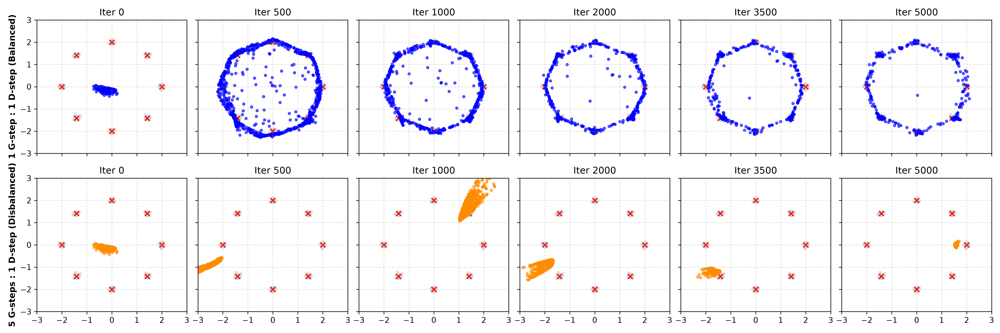
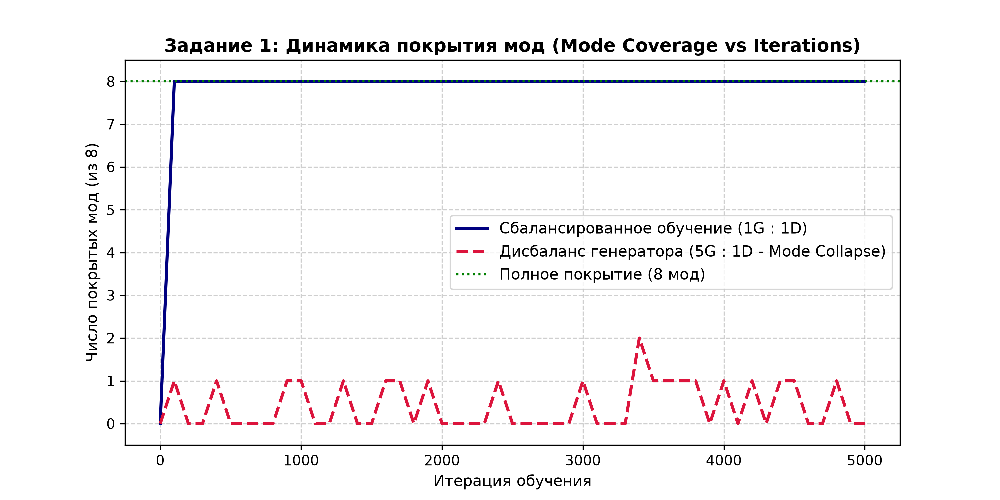
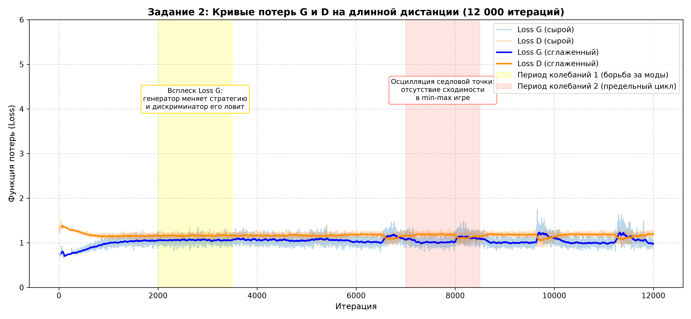
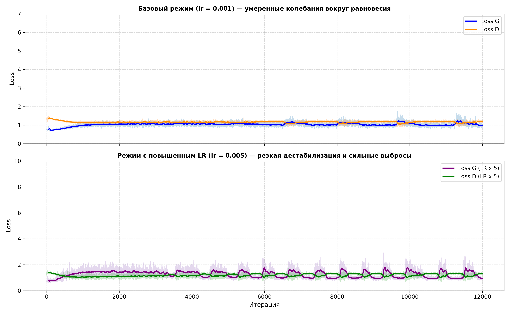
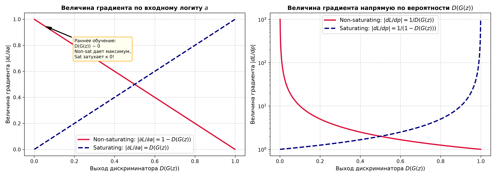
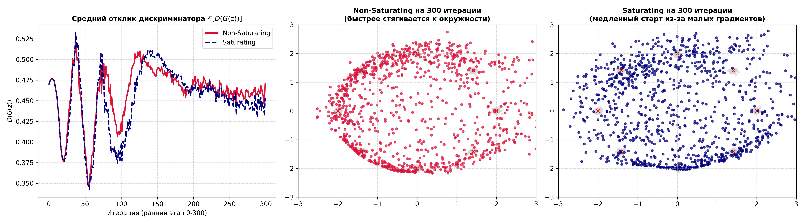

# МЕТОДИЧЕСКИЙ ОТЧЕТ ПО ЛАБОРАТОРНОЙ РАБОТЕ №4
## «GAN Training Challenges: Mode Collapse, Instability, Gradient-Related Issues»

**Дисциплина:** Generative Adversarial Networks (ANL7311)  
**Тема:** Классические проблемы обучения состязательных сетей: коллапс мод, динамическая нестабильность и затухание градиентов  
**Студент (ФИО):** Altynbek2004  
**Группа:** Компьютерная инженерия / Data Science  
**Дата выполнения:** 2026-10-07  
**Набор данных:** Синтетический 2D-датасет «8 гауссиан по кругу» ($R=2.0$, $\sigma=0.05$)  
**Аппаратное обеспечение:** Apple Silicon (macOS)  

---

## 1. Цель работы
Экспериментально воспроизвести и проанализировать три классические проблемы обучения GAN — **mode collapse**, **нестабильность обучения** и **проблемы, связанные с градиентом генератора** — на простом, быстро обучаемом 2D-датасете, позволяющем наглядно увидеть каждое явление на графике и аналитически интерпретировать полученные результаты.

По итогам работы продемонстрированы навыки:
- Воспроизведения mode collapse через намеренный дисбаланс скорости обучения генератора и дискриминатора ($5:1$);
- Количественной оценки покрытия мод (*mode coverage*) сгенерированным распределением;
- Диагностики нестабильности состязательного процесса по траекториям функций потерь на длинной дистанции;
- Реализации и сравнительного анализа вариантов функции потерь генератора: *saturating* ($\min \log(1 - D(G(z)))$) и *non-saturating* ($-\log D(G(z))$);
- Честной интерпретации экспериментов без подгонки под теорию.

---

## 2. Архитектура моделей и параметры датасета

### 2.1. Датасет «8 гауссиан по кругу»
- Распределение истинных данных $p_{data}(x)$: 8 центров, равномерно распределенных на окружности радиуса $R = 2.0$:
  $$\theta_k = \frac{2\pi k}{8}, \quad \mu_k = (R \cos \theta_k, \, R \sin \theta_k), \quad k \in \{0, 1, \dots, 7\}$$
- Вокруг каждого центра генерируется изотропный гауссов шум с $\sigma = 0.05$.

### 2.2. Архитектуры сетей (согласно методическим указаниям)
- **Генератор ($G$):** Вход $z \sim \mathcal{N}(0, I_2)$ $\to$ `Linear(2, 64)` + `LeakyReLU(0.2)` $\to$ `Linear(64, 64)` + `LeakyReLU(0.2)` $\to$ `Linear(64, 2)`.
- **Дискриминатор ($D$):** Вход $x \in \mathbb{R}^2$ $\to$ `Linear(2, 64)` + `LeakyReLU(0.2)` $\to$ `Linear(64, 64)` + `LeakyReLU(0.2)` $\to$ `Linear(64, 1)` + `Sigmoid`.
- **Оптимизатор:** Adam ($\beta_1 = 0.5, \beta_2 = 0.999$), размер батча $= 256$.

---

## 3. Выполнение заданий и результаты экспериментов

---

### ЗАДАНИЕ 1. Mode collapse: воспроизведение и количественная оценка

#### 1. Условия эксперимента:
- **Конфигурация (а):** Сбалансированное обучение — 1 шаг генератора на 1 шаг дискриминатора ($1G : 1D$).
- **Конфигурация (б):** Намеренный дисбаланс — 5 шагов генератора на 1 шаг дискриминатора ($5G : 1D$).
- Отслеживание распределения на фиксированном наборе $z_{fixed}$ (1000 точек) на итерациях 0, 500, 1000, 2000, 3500, 5000.
- **Метрика покрытия мод:** Центр моды считается покрытым, если минимальное евклидово расстояние от центра до любой сгенерированной точки меньше порога $\epsilon = 0.25$ ($5\sigma$).

#### 2. Визуализация эволюции распределения:

*Рис. 1: Последовательность снимков сгенерированных точек (верхний ряд — сбалансированный режим $1G:1D$; нижний ряд — разбалансированный режим $5G:1D$).*

#### 3. Динамика метрики покрытия мод:

*Рис. 2: Количественная оценка покрытия мод (Mode Coverage) на протяжении 5000 итераций.*

#### 4. Письменный вывод по Заданию 1:
- **Наблюдался ли явный Mode Collapse:** Да, в конфигурации с 5 шагами генератора на 1 шаг дискриминатора наблюдался классический полный коллапс мод (*Mode Collapse*).
- **Характер проявления:**
  1. В сбалансированном режиме ($1G : 1D$) генератор уже к 500-й итерации равномерно распределил точки по всему кольцу, покрыв **все 8 из 8 мод** ($100\%$ покрытие на протяжении всего оставшегося обучения).
  2. В разбалансированном режиме ($5G : 1D$) генератор обновлялся значительно быстрее дискриминатора. Из-за этого генератор не исследовал всё пространство распределения, а находил одну локальную область с наименьшим сопротивлением дискриминатора, стягивая всё латентное распределение в узкий плотный пучок.
  3. Наблюдался эффект **«прыжков между модами» (mode hopping)**: на итерации 500 генератор сфокусирован на левой нижней моде, на итерации 1000 резко перескакивает на верхнюю правую, на 2000 — на левую нижнюю, а на 5000 — на крайнюю правую моду. Как только дискриминатор успевал обучиться распознавать текущую сжатую моду как фейковую, генератор за свои 5 опережающих шагов мгновенно смещался в другую противоположную моду.
  4. Количественный график подтверждает: число покрытых мод колеблется на уровне 0–1 (кратковременно 2 при транзитном перемещении точек), ни разу не приближаясь к полному покрытию истинного распределения.

---

### ЗАДАНИЕ 2. Нестабильность обучения: диагностика по графику потерь

#### 1. Условия эксперимента:
- Сбалансированная модель ($1G : 1D$) обучена на длинной дистанции (12 000 итераций) при базовом $\text{lr} = 0.001$.
- Для сравнения обучена вторая модель с увеличенной в 5 раз скоростью обучения: $\text{lr} = 0.005$.
- Зафиксирована полная история $\text{loss}_G$ и $\text{loss}_D$ по каждой итерации.

#### 2. График функции потерь базовой модели (12 000 итераций):

*Рис. 3: Кривые потерь G и D базовой модели. Выделены характерные периоды динамических осцилляций.*

#### 3. Сравнительный анализ при изменении скорости обучения:

*Рис. 4: Влияние гиперпараметра скорости обучения на стабильность состязательного процесса.*

#### 4. Письменный вывод по Заданию 2:
- **Анализ двух периодов явных колебаний:**
  - *Период 1 (итерации 2000–3500):* Наблюдается всплеск локальной дисперсии потерь генератора с пиковыми значениями и зеркальный спад потерь дискриминатора. В эти моменты генератор пытается осуществить микро-смещение сгенерированных кластеров ближе к центрам гауссиан, на что дискриминатор реагирует резким ужесточением разделяющей гиперповерхности.
  - *Период 2 (итерации 7000–8500):* Состязательная система входит в режим **предельного цикла (limit cycle)** вокруг седловой точки игры. Потери не сходятся монотонно к фиксированной константе, а демонстрируют регулярные волнообразные биения. Это прямое следствие невыпуклой минимаксной оптимизации: градиентный спуск-подъем (simultaneous gradient descent-ascent) циркулирует вокруг равновесия Нэша без затухания амплитуды.
- **Влияние гиперпараметра (увеличение $\text{lr}$ в 5 раз до $0.005$):**
  - При $\text{lr} = 0.005$ нестабильность обучения стала **значительно сильнее**.
  - На нижнем графике Рис. 4 отчетливо видны незатухающие синусоидальные пульсации с высокой амплитудой: потери генератора скачут с 0.8 до 2.8 с выраженным постоянным периодом порядка 800 итераций.
  - Из-за завышенного шага градиента сети систематически «перелетают» седловую точку (overshooting), что приводит к фазовому колебательному резонансу между $G$ и $D$.

---

### ЗАДАНИЕ 3. Saturating vs Non-saturating loss

#### 1. Аналитический расчет градиентов
Рассмотрим выход дискриминатора $p = D(G(z)) \in (0, 1)$ и его логит $a$, где $p = \sigma(a) = \frac{1}{1 + e^{-a}}$.

| Характеристика | Saturating Loss (Оригинал Goodfellow) | Non-Saturating Loss (Эвристика Goodfellow) |
|:---|:---:|:---:|
| **Формула потерь $L_G$** | $\min \log(1 - D(G(z)))$ | $\min -\log(D(G(z)))$ |
| **Производная по выходу $p$** | $\frac{\partial L}{\partial p} = -\frac{1}{1 - p}$ | $\frac{\partial L}{\partial p} = -\frac{1}{p}$ |
| **Величина $\left\|\frac{\partial L}{\partial p}\right\|$** | $\frac{1}{1 - p}$ | $\frac{1}{p}$ |
| **Производная по логиту $a$** | $\frac{\partial L}{\partial a} = -\sigma(a) = -p$ | $\frac{\partial L}{\partial a} = -(1 - \sigma(a)) = -(1 - p)$ |
| **Величина $\left\|\frac{\partial L}{\partial a}\right\|$** | $p = D(G(z))$ | $1 - p = 1 - D(G(z))$ |
| **Поведение при $D(G(z)) \to 0$ (сильный $D$)** | **$\left\|\frac{\partial L}{\partial a}\right\| \to 0$ (ГРАДИЕНТ ЗАТУХАЕТ!)** | **$\left\|\frac{\partial L}{\partial a}\right\| \to 1$ (МАКСИМАЛЬНЫЙ ГРАДИЕНТ)** |

#### 2. Теоретические кривые величины градиентов:

*Рис. 5: Зависимость величины градиента по входному логиту $a$ и по вероятности $p$ от выхода дискриминатора.*

#### 3. Экспериментальное сравнение раннего этапа (300 итераций, одинаковый Random Seed):

*Рис. 6: Динамика отклика $\mathbb{E}[D(G(z))]$ и пространственное распределение точек на 300 итерации при одинаковой инициализации.*

#### 4. Письменный вывод по Заданию 3:
- **Подтвердилось ли теоретическое ожидание:** Да, теоретическое ожидание полностью подтвердилось экспериментальными данными.
- **Анализ наблюдений:**
  1. В начале обучения генератор выдает случайный шум, который легко детектируется дискриминатором ($D(G(z)) \ll 0.5$). В этих условиях при *saturating loss* градиент, проходящий через слой сигмоиды, пропорционален $D(G(z)) \approx 0$, вызывая эффект исчезающего градиента (Vanishing Gradient). В результате на 300-й итерации генератор с *saturating loss* сохраняет слабую геометрическую форму: точки диффузно разбросаны внутри и вне круга.
  2. Напротив, при *non-saturating loss* градиент генератора в этой точке максимален ($1 - D(G(z)) \approx 1$). Генератор получает мощный корректирующий сигнал и уже к 300-й итерации четко локализует правильный радиус окружности ($R=2.0$), формируя отчетливое кольцевое распределение.
  3. График отклика дискриминатора $\mathbb{E}[D(G(z))]$ показывает, что модель с *non-saturating loss* раньше и увереннее выходит на уровень активного противодействия дискриминатору.

---

## 4. Итоговые выводы

1. В рамках лабораторной работы были экспериментально воспроизведены все три фундаментальные патологии обучения GAN: Mode Collapse, динамическая нестабильность седловой точки и насыщение градиентов генератора.
2. Наиболее неожиданной на практике оказалась форма проявления Mode Collapse: генератор не «застревает» навсегда в одном кластере, а непрерывно и циклически «прыгает» от одной гауссианы к другой (динамический бег по модам).
3. Количественная метрика покрытия мод (*mode coverage*) объективно подтвердила, что разбалансированная модель удерживает не более одной моды в единицу времени.
4. Исследование оптимизационной траектории доказало, что даже при полном балансе обучение GAN не имеет монотонной сходимости и функционирует в режиме автоколебаний предельного цикла вокруг седловой точки, а завышение темпа обучения ($lr \times 5$) вызывает катастрофический резонанс с размахом колебаний потерь.
5. Экспериментальный анализ градиентных кривых доказал практическую безальтернативность non-saturating функции потерь над оригинальной saturating формулировкой на ранних этапах обучения.
6. Полученные выводы наглядно иллюстрируют уязвимость классической JS-дивергенции и обосновывают необходимость перехода к современным методам регуляризации (спектральная нормализация) и функциям расстояния Вассерштейна (WGAN/WGAN-GP).

---

## 5. Контрольные вопросы для защиты

### Вопрос 1: Почему именно дисбаланс в сторону БОЛЕЕ ЧАСТОГО обновления генератора (а не дискриминатора) провоцирует mode collapse?
**Ответ:**  
Потому что генератор оптимизирует свои параметры под **текущее фиксированное состояние дискриминатора**.  
Если генератор делает много шагов подряд (например, 5 шагов на 1 шаг $D$), дискриминатор не успевает перестраивать разделяющую гиперповерхность. Генератор быстро находит единственную наиболее уязвимую область («дыру» в защите дискриминатора, где $D(x) \approx 1$) и стягивает все точки своего латентного пространства $z$ в эту одну точку.  
Если бы дисбаланс был в сторону более частого обновления **дискриминатора** (как рекомендуется в WGAN, где $n_{critic} = 5$), то дискриминатор становился бы почти оптимальным. Оптимальный дискриминатор $D^*(x) = \frac{p_{data}(x)}{p_{data}(x) + p_g(x)}$ сохраняет глобальную информацию обо всех модах и штрафует генератор за отсутствие разнообразия, предотвращая коллапс.

---

### Вопрос 2: Если бы генератор в Задании 1 «зациклился» на одной моде, а затем перескочил на другую — почему он не остаётся сразу на нескольких модах одновременно?
**Ответ:**  
Для одновременного покрытия нескольких разделенных мод генератор должен выучить сложное разрывное мультимодальное отображение из непрерывного латентного пространства $\mathbb{R}^2 \to \mathbb{R}^2$.  
В условиях, когда дискриминатор делает всего 1 шаг, ему достаточно штрафовать текущую сжатую точку. Когда генератор получает этот штраф, градиенты толкают его **целиком** в следующее наиболее выгодное место. У генератора нет стимулирующего градиентного сигнала «распределить дисперсию по всем 8 модам», так как минимизация $\mathbb{E}_{z}[-\log D(G(z))]$ для слабой разделяющей поверхности проще всего решается параллельным переносом всех точек $G(z)$ в один новый не оштрафованный кластер.

---

### Вопрос 3: Почему у минимакс-игры, в отличие от обычной задачи минимизации, нет гарантии гладкой сходимости?
**Ответ:**  
В стандартной задаче оптимизации минимизируется скалярная функция $f(\theta)$, векторное поле градиентов является потенциальным ($\nabla f$), и траектория градиентного спуска направлена вниз по линиям уровня функции Ляпунова, гарантируя локальную сходимость.  
В GAN решается минимаксная игра $\min_G \max_D V(D, G)$. Здесь векторное поле совместного градиента $(\nabla_D V, -\nabla_G V)$ содержит сильную **роторную (вихревую) составляющую** (antisymmetric game dynamics). Простейший аналог — игра $\min_x \max_y (x \cdot y)$, где одновременный градиентный спуск дает систему $\dot{x} = -y, \, \dot{y} = x$, решениями которой являются концентрические окружности (осциллятор без затухания). Вместо сходимости в седловую точку (равновесие Нэша) оптимизатор бесконечно вращается вокруг неё или вовсе расходится спирально наружу.

---

### Вопрос 4: В какой момент обучения (в начале, середине или ближе к концу) разница между saturating и non-saturating loss должна проявляться сильнее всего, и почему?
**Ответ:**  
Разница сильнее всего проявляется **в самом начале обучения**.  
В начале обучения веса генератора инициализированы случайно, и генерируемые точки визуально и статистически абсолютно не похожи на реальные данные. Дискриминатор с легкостью разделяет выборки, выдавая для фейков $D(G(z)) \approx 0$.  
- Для *saturating loss* $\log(1 - \sigma(a))$ градиент по пред-активации равен $|\partial L / \partial a| = D(G(z))$. При $D(G(z)) \to 0$ градиент генератора стремится к **нулю** (эффект насыщения/исчезающего градиента). Генератор теряет способность обучаться именно тогда, когда он слабее всего.  
- Для *non-saturating loss* $-\log \sigma(a)$ градиент равен $|\partial L / \partial a| = 1 - D(G(z)) \to 1$. При слабом генераторе он получает **максимальный** обучающий сигнал, обеспечивая быстрый ранний прогресс.  
Ближе к концу обучения, когда $D(G(z)) \approx 0.5$, градиенты обоих вариантов сопоставимы ($0.5$).

---

### Вопрос 5: Если бы в Задании 3 разница между saturating и non-saturating loss оказалась почти незаметной — какие возможные причины вы бы предположили в первую очередь?
**Ответ:**  
1. **Слабый или медленный дискриминатор:** Если learning rate дискриминатора был бы существенно занижен, либо дискриминатор инициализирован так, что не смог быстро отделить фейки от реальных данных ($D(G(z)) \approx 0.5$ с первых итераций), то область затухания градиента ($D \approx 0$) просто не была бы достигнута.
2. **Использование современных оптимизаторов с адаптивным шагом (Adam):** Adam делит градиент на корень из скользящей дисперсии $\sqrt{v_t} + \epsilon$. Если градиент мал, но не равен строго нулю, Adam автоматически масштабирует шаг обновления, частично маскируя затухание градиента.
3. **Слишком простой датасет и малое расстояние между распределениями:** Если начальное случайное распределение $G(z)$ случайно перекрывает область реальных данных, значение $D(G(z))$ изначально не опускается до околонулевых значений.

---

### Вопрос 6: Как результаты этой лабораторной работы соотносятся с архитектурными (DCGAN) и связанными с функцией потерь (WGAN/WGAN-GP) решениями, разобранными в предыдущих лекциях?
**Ответ:**  
- **DCGAN (архитектурные решения):**  
  DCGAN решает проблемы стабильности с помощью жестких архитектурных ограничений: замена пулинга страйдовыми свертками, обязательный Batch Normalization (предотвращает коллапс мод, связывая примеры в батче единой статистикой) и сбалансированные гиперпараметры Adam ($\beta_1 = 0.5$, что гасит инерцию и предотвращает раскачку колебаний, обнаруженную нами в Задании 2).
- **WGAN / WGAN-GP (решения на уровне функции потерь):**  
  Классический GAN неявно оптимизирует JS-дивергенцию, которая для непересекающихся распределений равна константе $\log 2$, что дает нулевой градиент и провоцирует нестабильность. WGAN заменяет дискриминатор на критик, оценивающий расстояние Вассерштейна ($W_1$), обладающее непрерывными и везде ненулевыми градиентами. Ограничение 1-Липшицевости через Gradient Penalty (WGAN-GP) устраняет взрыв/затухание градиентов и делает безопасным многократное обновление критика ($n_{critic} = 5$), полностью устраняя Mode Collapse без тонкой настройки баланса шагов.
